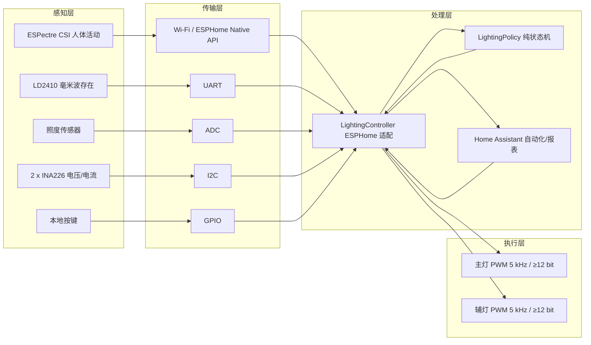

# ESPectre Plus 架构设计

> 状态：v0.2 单板台架基线（2026-11-16）
> 范围：基于 ESPectre Wi-Fi CSI 人体活动感知的 ESP32-S3 全屋智能照明节点。

## 1. 目标与边界

ESPectre Plus 把“人体存在感知、光照判断、双路调光、用电计量、本地按键、Home Assistant 接入”收拢到同一个房间节点。每个房间一个节点，节点之间不直接通信，统一由 Home Assistant 做跨房间联动和报表。

设计目标：

- **本地优先**：开灯/关灯判断在设备内完成，家庭网络或 Home Assistant 短时不可用不影响基本照明。
- **可解释**：控制策略是确定性的状态机，输入、阈值、延时、输出都能在日志和文档中追溯。
- **可维护**：纯策略代码与 ESPHome 适配层分离，策略可在 PC 上单元测试，不依赖硬件。
- **可复用**：一个 `room-node` 包 + 每房间一份 substitutions 文件；增加房间只改 YAML 参数。
- **可开源**：仓库不保存 Wi-Fi 密码、API/OTA 加密密钥、固定公网地址等隐私信息；所有秘密走 `secrets.yaml` 或环境变量。

不在本期范围：

- 灯具驱动板的 PCB 设计、220 V 强电布线、安规认证；
- 摄像头/麦克风等任何影像或音频采集；
- 人员身份识别、人数统计、跌倒检测等医疗/安防级功能；
- 云端账号、远程外网访问和厂商云依赖。

## 2. 系统分层



### 各层职责

| 层 | 职责 | 本项目的实现 |
|---|---|---|
| 感知层 | 获取人员、光照、用电、人工操作 | ESPectre（CSI 活动）、LD2410（存在）、ADC 照度、INA226、按键 |
| 传输层 | 把信号送到处理层 | 板内 I2C/UART/ADC/GPIO；跨设备用 Wi-Fi + ESPHome Native API |
| 处理层 | 判断有人/无人、光照是否不足、目标亮度、手动/自动 | `LightingPolicy` 纯 C++ 状态机 + `LightingController` 适配器；HA 只做远程入口和报表 |
| 执行层 | 把亮度指令变成光输出 | 两路 LEDC PWM，5 kHz，ESPHome 自动选择 ≥12 bit 分辨率（当前单板为 13 bit）；外接逻辑电平 MOSFET |

## 3. 代码结构

```text
firmware/
├── components/lighting_controller/   # 自定义 ESPHome 组件
│   ├── lighting_policy.{h,cpp}       # 纯 C++ 控制策略，可在 PC 上测试
│   ├── lighting_controller.{h,cpp}   # ESPHome 适配：读传感器、驱动 light、发布状态
│   └── __init__.py                   # YAML schema 与代码生成
├── packages/                         # 可复用的 ESPHome 配置包
│   ├── base.yaml                     # 芯片、Wi-Fi、API、OTA、日志
│   ├── sensors.yaml                  # ADC、I2C、UART、LD2410、INA226、ESPectre
│   ├── actuators.yaml                # LEDC、light、按键
│   └── control.yaml                  # lighting_controller、模式开关、状态实体
├── rooms/example-room.yaml           # 单个房间的 substitutions 入口
├── bench/                            # 单板自检和模拟传感器台架
└── tests/test_lighting_policy.cpp    # 主机侧单元测试
```

依赖方向：`rooms` → `packages` → `components`；`lighting_policy` 不包含任何 ESPHome 头文件，`lighting_controller` 才依赖 ESPHome。这样策略可以脱离硬件测试，也方便以后替换成 ESP-IDF 原生前端。

### 3.1 联调模拟边界

`simulator/` 是 NAS 侧预览，HTTP 层只依赖 `/api/state`、`/api/control`、`/api/wifi` 契约，不复制 `lighting_policy`。房间仍是 `mock_room.py`；WiFi 可在两个 provider 间切换：

```text
ESPectre 设备 :62587 /espectre/v1/csi
  → csi_http.py：V8 帧校验、I/Q 转幅值、断线重连
  → wifi.py：归一化、相邻帧形状变化
  → /api/wifi → Canvas：64 子载波 + CSI 波动
```

无 `ESPECTRE_CSI_URL` 时使用 `MockWifi`，页面标“模拟 CSI”并允许注入模拟干扰。真实模式禁用模拟按钮；`interference_pct` 是相对 CSI 波动指标，不是绝对干扰功率。`fake_csi_device.py` 只用于协议联调，不能替代现场 CSI 验收。

## 4. 控制状态机

### 4.1 输入

| 输入 | 来源 | 用途 |
|---|---|---|
| `mmwave_present` | LD2410 `has_target` | 判断房间是否有人，静坐也能保持 |
| `csi_motion` | ESPectre `motion_sensor` | 补充细微活动；作为存在保持的延长条件 |
| `illuminance` | ADC 照度 | 判断是否需要补光 |
| `main/aux_power` | INA226 | 仅上报，不参与开关灯判断 |
| `main/aux_button` | GPIO | 本地手动控制 |
| `auto_mode` | HA 开关/模式按键 | 自动/手动切换 |

### 4.2 存在判断

```text
raw_present = mmwave_present
              OR (csi_motion 在最近 csi_hold_ms 内出现过)

raw_present 连续保持 presence_confirm_ms
    -> occupied = true

occupied 且 raw_present 消失连续 absence_timeout_ms
    -> occupied = false
```

- 默认 `presence_confirm_ms = 1000`，避免一次 Wi-Fi 扰动或雷达毛刺直接开灯。
- 默认 `absence_timeout_ms = 300000`（300 s），避免短时漏检导致误关灯。
- `csi_hold_ms` 默认 60000（60 s）。CSI 活动是“瞬间动作”信号，不能单独当成持续存在；它只延长 `raw_present`。
- 如果 LD2410 不可用但 ESPectre 可用，系统降级为 CSI-only；反之亦然。两者都不可用时进入 `SENSOR_FAULT`，保持当前灯光状态并上报故障。

### 4.3 光照与调光

采用双阈值滞回，避免在阈值附近反复开关：

- `lux < 250 lx`：允许开灯或增加补光；
- `lux > 350 lx`：允许减少补光，但必须持续 `lux_reduce_delay_ms`（默认 60 s）；
- 250–350 lx：保持当前状态。

目标亮度按光照亏欠比例计算：

```text
deficit = clamp((lux_on - lux) / lux_on, 0, 1)
main_brightness = min_brightness + deficit * (max_brightness - min_brightness)
```

- 环境越暗，主灯越亮；接近 250 lx 时降到 `min_brightness`（默认 20%）。
- 辅灯只在 `lux < aux_threshold`（默认 80 lx）且有人时开启，亮度默认 40%。
- 亮度变化使用 1 s 淡入淡出，避免突兀。
- 光照高于 350 lx 时，先等待 60 s，再按 10% 步长逐步降低目标亮度；若光照回落到 250 lx 以下，恢复目标亮度。这样不会因为灯自身照亮传感器而立刻关灯。

### 4.4 手动/自动

| 状态 | 进入方式 | 行为 |
|---|---|---|
| `AUTO` | 上电默认；模式开关打开；模式按键切回 | 策略自动控制两路灯 |
| `MANUAL` | 用户按灯键；HA 直接调灯；模式开关关闭 | 策略不碰灯，只更新占用状态；用户完全控制 |
| `SENSOR_FAULT` | 两路存在传感器都不可用 | 保持最后输出，上报故障；手动仍可用 |

手动优先是硬规则：只要用户在本地或 HA 动过灯，系统就进入 `MANUAL`，直到用户显式切回 `AUTO`。这样自动逻辑不会和人的操作“抢灯”。

## 5. 用电计量与报表

- 两路 INA226 以 5 Hz 读取母线电压、电流、功率（`update_interval: 200ms`），再经 `throttle: 5s` 每 5 s 上报 HA；地址分别为 `0x40`、`0x41`（由 A0 引脚选择）。
- 固件只上报瞬时功率，不在设备端做长期累计，避免 Flash 写入磨损和断电丢数。
- Home Assistant 用 `integration`（黎曼和）把 W 转成 kWh，再用 `utility_meter` 做日/月/年统计；HA 的 Energy Dashboard 直接展示。
- 每路电能 = 功率对时间积分；总电能 = 两路之和。成本估算用 HA `input_number` 电价，不写死在固件。

## 6. 多房间扩展

每个房间一份 `firmware/rooms/<room>.yaml`，只改：

- `room_name`、`room_slug`、`node_name`；
- 静态 IP（建议 DHCP 保留）；
- GPIO 引脚、I2C 地址、分流电阻/最大电流；
- 阈值和亮度参数（可先用默认值，现场调试）。

所有房间共用 `packages/*.yaml` 和同一个 `lighting_controller` 组件。HA 侧按房间前缀生成实体，跨房间联动放在 HA 自动化里，不写成固件之间的点对点通信。

## 7. 关键设计决策

| 决策 | 选择 | 理由 |
|---|---|---|
| 固件框架 | ESPHome + ESP-IDF | 复用 ESPectre 的 ESPHome 前端、原生 HA API、OTA、日志；比裸 ESP-IDF 少写网络/配置代码 |
| 控制逻辑位置 | 设备内 C++ 状态机 | 断网可用；比 YAML 自动化更容易测试和维护 |
| 策略与适配分离 | `LightingPolicy` 纯 C++ | 主机侧可跑单元测试，不依赖 ESP32 |
| 通信 | Wi-Fi + ESPHome Native API | 与现有 ESPectre/HA 一致，不增加 ZigBee 协调器；照明数据量小 |
| 计量 | 瞬时功率 + HA 积分 | 避免设备端长期存储；HA 已有成熟 Energy Dashboard |
| 开源许可 | GPL-3.0 | 上游 ESPectre 为 GPLv3；本项目作为衍生作品保持同许可 |

## 8. 风险与容错

| 风险 | 处理 | 预期效果 |
|---|---|---|
| Wi-Fi CSI 受环境扰动误触发 | 1 s 确认 + 300 s 无人延时 + LD2410 持续存在补足 | 减少单次扰动导致的误开/误关 |
| 静坐时 CSI 活动少 | LD2410 存在传感器为主，CSI 为辅 | 静坐场景仍能保持开灯 |
| 照度传感器被灯直射 | 双阈值 + 60 s 降亮延时 + 逐步调光 | 避免灯一亮就关灯的振荡 |
| I2C 总线锁死/INA226 掉线 | 10 s 超时后功率实体变 unavailable；不参与控制 | 计量故障不影响照明，HA 可告警 |
| 照度 ADC 或雷达断线 | 照度 1 s、毫米波 5 s 超时后标记无效 | 照度失效回退 60%，雷达失效可降级到 CSI |
| HA/网络中断 | 本地策略和按键继续工作 | 基本照明可用；恢复后自动同步 |
| 24 V 灯路过流/短路 | 保险丝、TVS、MOSFET 驱动、共地 | 限制故障电流，保护主板和电源 |
| 传感器都失效 | `SENSOR_FAULT` 保持最后状态并上报 | 不盲目开关灯，便于人工处理 |

## 9. 后续演进

1. 现场标定照度—PWM 曲线和 LD2410 灵敏度。
2. 增加每房间的“夜间最低亮度”和“阅读/观影”场景。
3. 用 HA 的 `adaptive_lighting` 或自建 PID 做闭环照度控制（需实测避免振荡）。
4. 增加第二块 ESPectre 节点做跨房间存在融合（HA 层）。
5. 若需要电池供电节点，再评估 ZigBee/Thread；当前固定供电场景 Wi-Fi 更合适。
