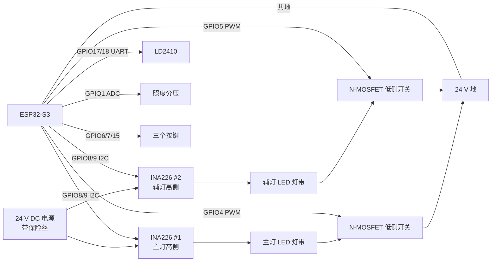

# 硬件与接线

> 本文件是台架接线说明，不是安规设计文件。24 V 灯路可能达到数安培，接线前断电，第一次上电先用限流电源或保险丝。

## 1. 系统拓扑



## 2. 引脚分配（示例房间）

| 功能 | ESP32-S3 引脚 | 说明 |
|---|---|---|
| 主灯 PWM | GPIO4 | LEDC 5 kHz，经 MOSFET 驱动 |
| 辅灯 PWM | GPIO5 | LEDC 5 kHz，经 MOSFET 驱动 |
| 主灯按键 | GPIO6 | 内部上拉，按下接地 |
| 辅灯按键 | GPIO7 | 内部上拉，按下接地 |
| 模式按键 | GPIO15 | 内部上拉，按下接地 |
| I2C SDA | GPIO8 | INA226 #1/#2 |
| I2C SCL | GPIO9 | INA226 #1/#2 |
| LD2410 TX → ESP RX | GPIO17 | ESP 的 RX 接雷达 TX |
| ESP TX → LD2410 RX | GPIO18 | ESP 的 TX 接雷达 RX |
| 照度 ADC | GPIO1 | ADC1 通道，0–2.5 V |

> 不同开发板的引脚可用性不同；避开启动 strapping 引脚（GPIO0/3/45/46 等）和 USB 专用引脚。改引脚只需改 `firmware/rooms/*.yaml` 的 substitutions。

## 3. 24 V 灯路

- 每路：24 V 电源 → 保险丝 → INA226 高侧分流 → LED 灯带正极；灯带负极 → N-MOSFET 漏极；MOSFET 源极 → 24 V 地。
- MOSFET 用逻辑电平 N 沟道管（如 IRLZ44N、AO3400 模块），栅极串 220 Ω，栅极对地 10 kΩ 下拉，确保 ESP32 复位时灯关断。
- ESP32 与 24 V 电源必须共地；否则 PWM 没有参考电平。
- 每路加保险丝（例如 2 A 慢断）和 TVS/续流二极管（SS34 或 SMBJ 系列）抑制灯带线缆电感。
- 灯带电流按 24 W / 24 V ≈ 1 A 估算；2 A 保险丝留有余量。实际电流用 INA226 读数核对。
- 220 V 市电只进入认证的 24 V 电源，不要用 MOSFET 直接切市电。

## 4. INA226 计量

INA226 是高侧电流/功率监测器，总线电压最大 36 V，适合 24 V 灯路。

| 项目 | 建议 |
|---|---|
| 分流电阻 | **0.01 Ω**（R010）或模块自带的可更换分流；0.1 Ω 在 1 A 时压降 0.1 V，2 A 时会超过 INA226 的 ±81.92 mV 量程 |
| 最大电流配置 | 2.0 A（对应 0.01 Ω 时满量程 8.19 A，留足余量） |
| I2C 地址 | #1 `0x40`（A0=GND），#2 `0x41`（A0=VCC） |
| 总线 | 100 kHz，SDA/SCL 各 4.7 kΩ 上拉到 3.3 V；两个模块并联时确认总上拉约 2.35 kΩ 仍可使用 |
| 接线 | 24 V 电源正 → 分流电阻 → 灯带正；INA226 的 VBUS 接灯带正（分流后），GND 接 24 V 地 |

注意：INA226 的 I2C 侧是 3.3 V 逻辑，不要把它接到 5 V I2C 总线；模块若有 5 V 供电版本，确认逻辑电平转换。

## 5. 照度采样

报告要求 0–2.5 V、12 位、20 Hz、5 次平均。示例电路：

```text
5 V ── R1 10k ──┬── R2 10k ── GND
                │
                ├── LDR (GL5528) ── GND
                │
                └── 100 nF ── GND
                └── GPIO1 (ADC)
```

- 5 V 经 R1 与 LDR 分压，再用 R2 与 LDR 的下半段分压，使 ADC 节点最高约 2.5 V（具体值随 LDR 型号变化）。
- 100 nF 与分压电阻构成低通滤波，减少 Wi-Fi 开关噪声。
- ESPHome 配置为 12 dB 衰减、50 ms 采样（20 Hz）、5 点滑动平均；再用 `calibrate_linear` 把电压映射为 lx。
- 标定：用照度计分别记录 0 lx、250 lx、500 lx、1000 lx 时的 ADC 电压，改 `calibrate_linear` 的 datapoints。不要直接用理论值当最终标定。

## 6. LD2410

- 供电 5 V；UART 逻辑 3.3 V；TX/RX 交叉连接。
- 默认波特率 256000；若模块被改过，改 `firmware/packages/sensors.yaml` 的 `baud_rate`。
- 安装在房间角落、避开空调出风口和窗帘；毫米波能穿薄墙，调试时注意相邻房间误检。
- `has_target` 作为“有人”的主判据；`has_moving_target`/`has_still_target` 可用于后续细化。

## 7. 按键

- 三个轻触按键分别接 GPIO6/7/15 与 GND，使用 ESP32 内部上拉。
- 软件 20 ms 去抖；短按切换对应灯或自动/手动模式。
- 按键是本地手动优先的入口：按任意灯键后系统进入 MANUAL，直到再按模式键或 HA 开关切回 AUTO。

## 8. 上电检查顺序

1. 不接灯带，只接 ESP32 + I2C + 雷达，确认能启动、日志无 I2C 错误。
2. 用万用表确认 24 V 电源极性和保险丝。
3. 接一路灯带，串限流电源，测 PWM 波形（5 kHz，占空比随亮度变化）。
4. 接 INA226，核对空载电流和 1 A 左右负载的读数。
5. 两路同时工作，检查共地、发热和 Wi-Fi RSSI。
6. 最后装壳，留出散热和天线净空。
